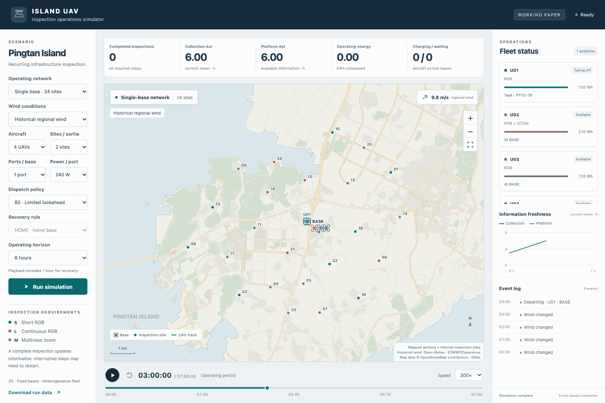
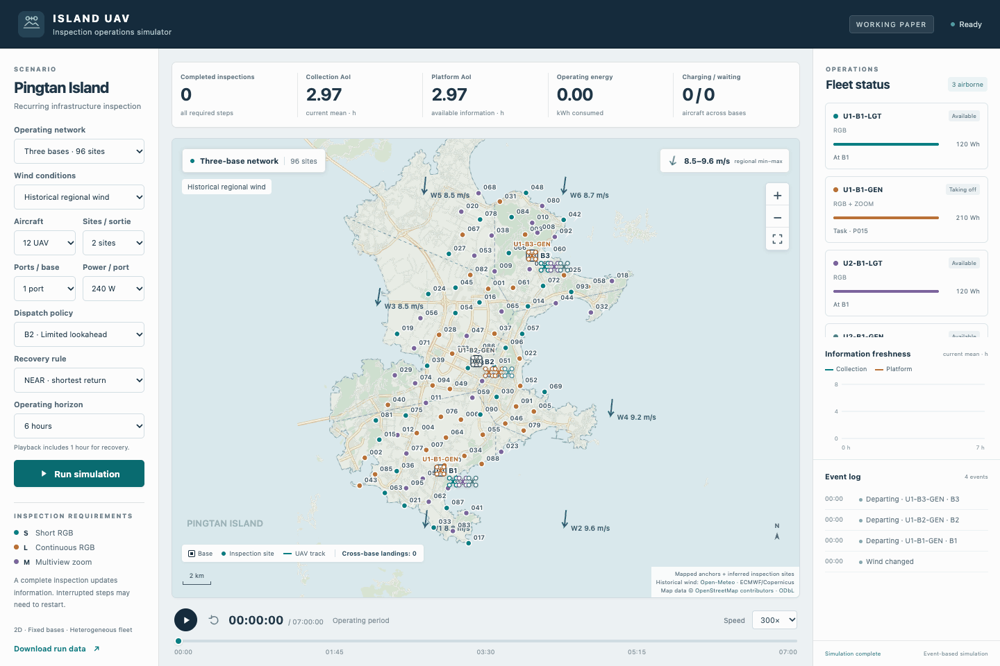

# Island UAV inspection simulation

Code for a working paper prepared for journal submission: *A discrete-event simulation framework for wind-constrained UAV inspection operations on islands*.

A configurable environment for recurring inspection, heterogeneous UAVs, regional wind and shared bases. The 2D browser interface replays actual simulation events over an offline OpenStreetMap-derived map.

**Single-base inspection**



**Multi-base inspection**



**Python 3.10+ · No runtime dependencies**

```bash
python -m pip install -e .
island-uav serve --open
```

Open **http://127.0.0.1:8000**. Choose a scenario, run it and press Play.

```bash
island-uav run --config examples/compact.json --output runs/demo --replay
island-uav reproduce --case all --output runs/references
```

The reproduction command checks two archived paper cases. See [configuration and outputs](docs/usage.md) and [input sources](docs/data.md). Code: MIT; OSM data: ODbL.
