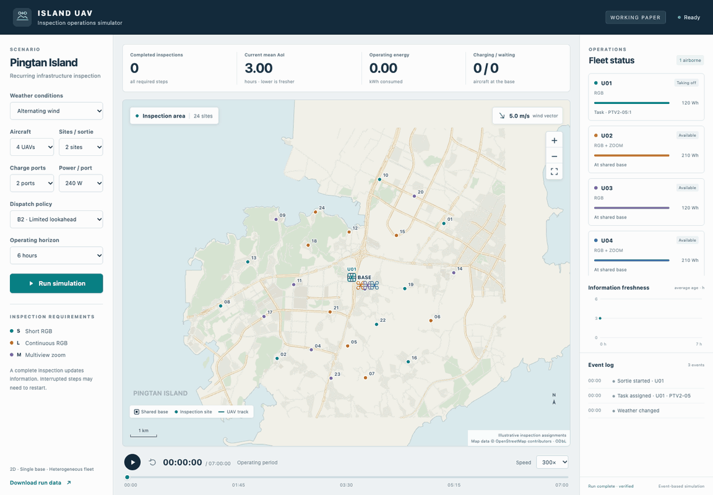

# Island UAV inspection simulation

Research code for a working paper under submission: *A discrete-event simulation framework for evaluating weather-constrained UAV inspection operations*.

A lightweight environment for recurring UAV inspection, changing wind, heterogeneous aircraft and shared charging. The 2D browser interface replays actual simulation events on an OpenStreetMap-derived map.



**Python 3.10+ · No runtime dependencies**

```bash
python -m pip install -e .
island-uav serve
```

Open **http://127.0.0.1:8000**. Choose a configuration, run the simulation and press Play. The bundled map works offline.

```bash
island-uav run --config examples/pingtan.json --output outputs/demo
island-uav reproduce --output outputs/paper-case
```

The second command checks one full paper case against archived metrics. See [configuration and outputs](docs/usage.md) and [data sources](docs/data.md). Code: MIT; OSM data: ODbL.
